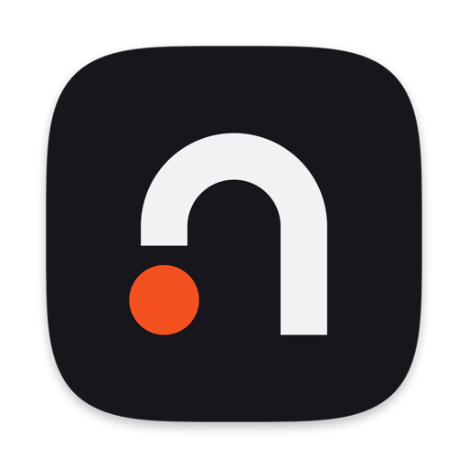

<p align="center">
  
</p>

<h1 align="center">Niche</h1>

<p align="center">
  A native macOS browser with the sidebar at its heart.<br>
  Real Chromium underneath, Swift on top, nothing in the way.
</p>

<p align="center">
  
  
  <a href="https://github.com/niche-browser/niche/actions/workflows/ci.yml"></a>
  <a href="LICENSE"></a>
</p>

Niche is built for people who live in their browser. Tabs live in a sidebar, grouped into
spaces. A command bar on <kbd>⌘</kbd> <kbd>T</kbd> finds tabs, history, bookmarks and commands.
Today's tabs tidy themselves into an archive, and pinned tabs remember where they started.

The interface is AppKit and SwiftUI. Pages run in Chromium through the Chromium Embedded
Framework (CEF), so sites, DevTools and Chrome Web Store extensions behave as they do in Chrome.

## What's in it

- **Spaces:** separate sidebars, each with its own theme and, if you like, its own profile.
- **Pinned tabs and folders**, plus favorites across the top of the sidebar.
- **Today tabs** that archive themselves after a while. The archive is searchable.
- **Command bar** (<kbd>⌘</kbd> <kbd>T</kbd>): open, search and switch from one field.
- **Split view**, **Little Windows** for links from other apps, and **Peek** previews.
- **Live folders** that follow GitHub, RSS and other feeds.
- **Picture in Picture**, a **Library** of downloads and media, and **Developer Mode**.
- **Profiles** and **private windows**.
- **Extensions** from the Chrome Web Store, Manifest V2 included (uBlock Origin works).
- **Built-in blocker** for more than 22,000 ad and tracker domains.
- **Tidy Tabs**, which runs on the Mac's own Apple Intelligence model. Nothing goes to a server.

## Import

On first launch, or later from Niche ▸ Import from Arc or Dia…, Niche brings over:

- **Arc:** spaces, pinned tabs, folders, favorites and the archive, plus passwords and sign-ins.
- **Dia, Chrome, Brave, Edge, Opera, Vivaldi, Chromium, Helium:** tabs, bookmarks, history,
  passwords, sign-ins and extensions.
- **Zen and Firefox:** open tabs, bookmarks and history, and Zen's spaces, Essentials and
  pinned tabs.
- **Safari:** whatever Safari exports itself (File ▸ Export Browsing Data): bookmarks,
  history and passwords.

Spaces with the same name merge, tabs that are already there are skipped, and every step can
be skipped.

## Keyboard

Every shortcut can be changed in Settings ▸ Shortcuts. The ones you'll use most:

| Shortcut | Action |
|---|---|
| <kbd>⌘</kbd> <kbd>T</kbd> | New tab (command bar) |
| <kbd>⌘</kbd> <kbd>L</kbd> | Edit the URL |
| <kbd>⌘</kbd> <kbd>W</kbd> | Close tab |
| <kbd>⇧</kbd> <kbd>⌘</kbd> <kbd>T</kbd> | Restore closed tab |
| <kbd>⌘</kbd> <kbd>D</kbd> | Pin or unpin tab |
| <kbd>⌘</kbd> <kbd>S</kbd> | Show or hide the sidebar |
| <kbd>⌃</kbd> <kbd>1</kbd>…<kbd>9</kbd> | Go to space |
| <kbd>⌘</kbd> <kbd>1</kbd>…<kbd>9</kbd> | Go to tab |
| <kbd>⌃</kbd> <kbd>Tab</kbd> | Switch to recent tab |
| <kbd>⌃</kbd> <kbd>⇧</kbd> <kbd>=</kbd> | Split view |
| <kbd>⌥</kbd> <kbd>⌘</kbd> <kbd>N</kbd> | New Little Window |
| <kbd>⇧</kbd> <kbd>⌘</kbd> <kbd>N</kbd> | New private window |
| <kbd>⇧</kbd> <kbd>⌘</kbd> <kbd>C</kbd> | Copy URL |
| <kbd>⌘</kbd> <kbd>Y</kbd> | History and archive |
| <kbd>⌥</kbd> <kbd>⌘</kbd> <kbd>I</kbd> | DevTools |

Pages get the first chance at shortcuts Niche doesn't reserve, as in Chrome, so ⌘F in Google
Docs still works.

## Privacy

Niche has no account and no server, and collects no analytics. Spaces, tabs and the archive
are plain JSON in `~/Library/Application Support/Niche`. Pages run in Chromium's sandbox with
site isolation, and passwords and cookies are encrypted with a key in your Keychain. To report
a vulnerability, see [SECURITY.md](SECURITY.md).

## Build from source

You need macOS 14 or later on Apple silicon, Xcode 16 or later, and CMake (`brew install cmake`).

```sh
scripts/dev.sh            # debug NicheDev.app, rebuilt and relaunched on every save
scripts/build.sh          # release build at build/Niche.app
scripts/test.sh           # the full test suite
```

The first build downloads the pinned CEF engine into `vendor/`. With
[just](https://just.systems) installed, `just` lists every script. The code layout, tests and
scripting hooks are in [docs/development.md](docs/development.md).

## Licence

[MIT](LICENSE).
